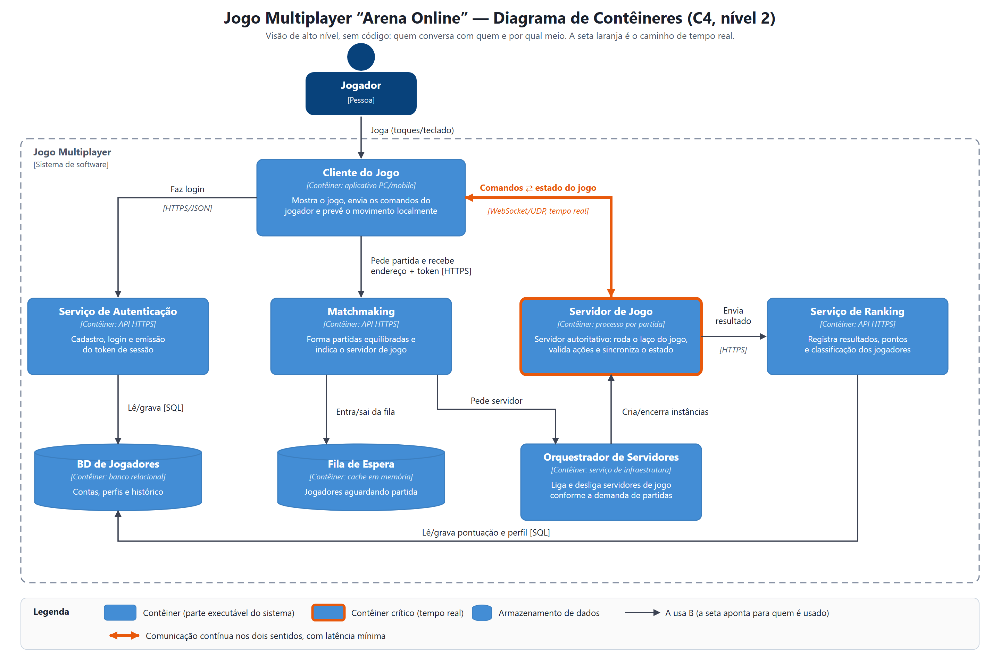

# Estudo de Caso — Escolha de Estilos Arquiteturais

**Disciplina:** Arquitetura de Software
**Integrantes do grupo:** _(preencher com nomes e matrículas)_

> Entrega 100% teórica/modelagem: este repositório não contém código. Reúne a análise dos sistemas, as decisões justificadas, os slides da apresentação e um diagrama de alto nível.

Escolhemos o estilo arquitetural de **três sistemas fictícios** com necessidades bem diferentes: um e-commerce, um app bancário e um jogo multiplayer.

## Conteúdo do repositório

| Caminho | Descrição |
|---|---|
| [`README.md`](README.md) | Este documento: análise, decisões, justificativas e reflexão (Partes 1, 2 e 4) |
| [`docs/matriz-de-decisao.md`](docs/matriz-de-decisao.md) | Comparação ponderada dos estilos candidatos, para tornar as escolhas explícitas e discutíveis |
| [`slides/apresentacao.pdf`](slides/apresentacao.pdf) | Slides da apresentação oral (Parte 3) |
| [`slides/roteiro-de-fala.md`](slides/roteiro-de-fala.md) | Roteiro de apoio para a apresentação oral |
| [`diagramas/jogo-multiplayer-c4.png`](diagramas/jogo-multiplayer-c4.png) | Diagrama C4 do jogo multiplayer, em PNG (bônus) |
| [`diagramas/jogo-multiplayer-c4.svg`](diagramas/jogo-multiplayer-c4.svg) | O mesmo diagrama, em SVG (vetorial) |

## Resumo das decisões

| Sistema | Estilo escolhido | Ideia central |
|---|---|---|
| **E-commerce** | **Microsserviços** com comunicação **orientada a eventos** | Escalar só o que está sob pressão e deixar cada time publicar sua parte sem depender dos outros |
| **App bancário** | **Monolito modular** (em camadas, banco relacional único) | Consistência forte e segurança valem mais do que escala horizontal extrema |
| **Jogo multiplayer** | **Cliente-servidor** com **servidor autoritativo** e WebSockets/UDP | Latência mínima e um único "juiz" do estado do jogo |

---

## Parte 1 — Análise dos sistemas

### 1.1 E-commerce — "MercadoGrande"

**Contexto (premissas do grupo):** loja online de varejo com milhões de produtos e vários times de desenvolvimento, cada um dono de uma área: catálogo, busca, carrinho, pedidos, pagamentos e logística. O tráfego normal é estável, mas em datas como a Black Friday ele multiplica várias vezes, principalmente em catálogo, busca e carrinho.

**Requisitos não funcionais críticos**

| Requisito | Por que importa neste sistema |
|---|---|
| **Escalabilidade seletiva (picos)** | Na Black Friday, busca e carrinho recebem muito mais carga do que o cadastro de clientes. Escalar tudo junto desperdiça dinheiro. |
| **Alta disponibilidade e tolerância a falhas** | Se as "recomendações" caírem, o cliente ainda precisa conseguir comprar. Cada minuto fora do ar é venda perdida. |
| **Consistência eventual (na maior parte)** | Pode haver pequeno atraso para refletir uma mudança de preço ou de estoque exibido. Só o pagamento e a reserva de estoque exigem rigor. |
| **Desempenho de leitura** | Busca e páginas de produto precisam responder rápido, ou o cliente desiste. |
| **Evolutividade / autonomia dos times** | Times diferentes precisam publicar novas versões no seu ritmo, sem coordenar um "deploy de tudo". |

### 1.2 App bancário — "BancoDigital Alfa"

**Contexto (premissas do grupo):** banco digital com conta corrente, extrato, transferências, Pix e cartões. O sistema lida com dinheiro real e com exigências regulatórias e de proteção de dados (como a LGPD). Uma equipe de porte médio, com perfil mais conservador, mantém o sistema.

**Requisitos não funcionais críticos**

| Requisito | Por que importa neste sistema |
|---|---|
| **Segurança extrema** | Autenticação forte, criptografia e controle de acesso rígido. Um vazamento ou fraude é um dano grave à confiança e ao negócio. |
| **Consistência forte (ACID)** | O saldo nunca pode ficar errado: uma transferência debita e credita **junto**, ou não acontece. |
| **Auditoria e rastreabilidade** | É preciso saber quem fez o quê e quando, com registros que não podem ser alterados. É uma exigência regulatória. |
| **Disponibilidade 24x7** | O Pix funciona o tempo todo, então o sistema precisa se recuperar rápido de falhas. |
| **Previsibilidade** | O comportamento deve ser correto e previsível, mais importante do que velocidade máxima. |

### 1.3 Jogo multiplayer — "Arena Online"

**Contexto (premissas do grupo):** jogo competitivo em tempo real, com partidas curtas entre cerca de 10 jogadores. Cada jogador precisa ver o mesmo mundo, quase ao mesmo tempo que os outros. Trapaça arruína a experiência e o negócio do jogo.

**Requisitos não funcionais críticos**

| Requisito | Por que importa neste sistema |
|---|---|
| **Latência ultrabaixa** | Cada atraso de dezenas de milissegundos é sentido pelo jogador. |
| **Tempo real** | O estado do jogo é atualizado várias vezes por segundo (dezenas de "ticks" por segundo). |
| **Sincronização de estado** | Todos os jogadores devem concordar sobre onde cada um está e o que aconteceu. |
| **Resistência a trapaças** | A decisão final sobre o que vale não pode ficar na máquina do jogador. |
| **Escalabilidade por partida** | O número de partidas simultâneas varia ao longo do dia, e a infraestrutura deve crescer e encolher junto. |

---

## Parte 2 — Decisão e justificativa

> A comparação ponderada que apoia estas escolhas está em [`docs/matriz-de-decisao.md`](docs/matriz-de-decisao.md).

### 2.1 E-commerce → Microsserviços com comunicação orientada a eventos

**Justificativa técnica**
- **Escala seletiva:** busca, catálogo e carrinho recebem a maior parte da carga na Black Friday. Em microsserviços, cada um escala sozinho, e os demais continuam pequenos.
- **Isolamento de falhas:** se o serviço de recomendações cair, o checkout continua funcionando. Num monolito, um defeito pode derrubar tudo.
- **Consistência eventual com eventos:** quando um pedido é confirmado, o serviço de pedidos publica um evento, e estoque, logística e notificações reagem a ele sem travar o cliente. Para o fluxo pedido–pagamento–estoque, usa-se uma **Saga** (uma sequência de passos com compensação, por exemplo, estornar o pagamento se o estoque acabar).

**Justificativa de negócio**
- Os times de catálogo, pagamentos e logística conseguem **publicar versões de forma independente**, lançando mais rápido e com menos risco de "quebrar o outro time".
- Escalar só as partes sob pressão **reduz o custo** de infraestrutura nos picos.
- Cada minuto de indisponibilidade na Black Friday tem custo direto em vendas.

**Alternativas descartadas**
- *Monolito (simples ou modular):* é o melhor ponto de partida para um produto novo, mas escala tudo junto e acopla as publicações de vários times. No contexto do MercadoGrande (muitos times, picos fortes), vira gargalo.
- *SOA com barramento (ESB):* o barramento central vira ponto único de falha e de gargalo organizacional.

**Trade-offs que aceitamos (e como lidar)**
- **Complexidade operacional:** muitos serviços, rede entre eles, e depuração mais difícil. *Mitigação:* automação de implantação, monitoramento centralizado e rastreamento distribuído desde o início.
- **Consistência eventual:** o sistema precisa tolerar estados intermediários (por exemplo, "pedido recebido, aguardando confirmação"). *Mitigação:* mostrar o status claramente ao cliente e usar Sagas nos fluxos críticos.
- **Exige maturidade da equipe.** Esta decisão **só vale se a equipe estiver preparada** para operar sistemas distribuídos.

**Quando reavaliar:** se a empresa fosse pequena (poucos desenvolvedores, produto em validação), recomendaríamos **começar por um monolito modular** e extrair serviços aos poucos, conforme a dor aparecer.

### 2.2 App bancário → Monolito modular

**Justificativa técnica**
- **Consistência forte e controle transacional:** com um único banco relacional e um único processo, uma transferência (débito + crédito) é uma **transação ACID** simples e confiável. Em microsserviços, o mesmo resultado exigiria transações distribuídas ou Sagas, mais difíceis de garantir.
- **Segurança:** um único ponto de entrada e menos serviços em rede significam **menor superfície de ataque** e um perímetro mais fácil de proteger e de auditar.
- **Auditoria:** a trilha de auditoria (registro de quem fez o quê, só de inclusão) fica na mesma transação da operação, então nunca há operação sem registro.
- **Modular, e não "bagunçado":** o código é dividido em módulos com fronteiras claras (contas, transferências/Pix, cartões, extrato, antifraude). Isso mantém a organização e deixa a porta aberta para separar um módulo no futuro.

**Justificativa de negócio**
- Num banco, **errar o saldo custa mais do que ser lento**: multas, perda de confiança e risco regulatório.
- Uma equipe de porte médio **entrega com menos custo** e menos risco operacional num monolito do que operando dezenas de serviços.
- Menos peças móveis reduzem o custo de conformidade e de auditoria.

**Alternativas descartadas**
- *Microsserviços:* resolvem escala horizontal extrema, que não é a maior dor deste banco, e trazem transações distribuídas, mais superfície de ataque e custo operacional.
- *Orientado a eventos puro (event sourcing):* excelente para auditoria, mas muito complexo para a equipe. Aproveitamos a ideia de forma simples, com uma trilha de auditoria só de inclusão.
- *Monolito sem módulos:* é simples no início, mas tende a virar uma "bola de lama" difícil de manter.

**Trade-offs que aceitamos (e como lidar)**
- **Escala:** escala principalmente na vertical, com réplicas de leitura para extrato e consultas. *Mitigação:* o tráfego de um banco é previsível, e a leitura pesada vai para réplicas.
- **Publicação:** uma nova versão mexe no sistema inteiro. *Mitigação:* testes automatizados fortes, implantações graduais e janelas controladas.
- **Disponibilidade:** o monolito é um ponto único. *Mitigação:* várias instâncias atrás de um balanceador, banco com failover automático e várias zonas de disponibilidade.

**Quando reavaliar:** se algum módulo passar a exigir escala própria ou ritmo de entrega diferente (por exemplo, notificações ou o gateway do Pix), ele pode ser **extraído** como serviço, sem refazer o resto.

### 2.3 Jogo multiplayer → Cliente-servidor com servidor autoritativo (WebSockets/UDP)

**Justificativa técnica**
- **Latência mínima:** o jogador mantém uma conexão **contínua e direta** com o servidor da sua partida (WebSocket ou UDP), sem saltos intermediários. Cada chamada HTTP entre serviços acrescentaria atraso que o jogador sentiria.
- **Servidor autoritativo:** o servidor é o "juiz": recebe os comandos dos jogadores, valida, calcula o estado do jogo e envia o resultado a todos. Isso garante **sincronização** (todos veem o mesmo mundo) e **impede trapaças** (o cliente não decide nada).
- **Escala por partida:** cada partida roda em seu próprio processo de servidor. Um orquestrador liga e desliga servidores conforme a demanda. Só o que não é tempo real (login, matchmaking, ranking) fica em serviços separados, comuns, via HTTPS.

**Justificativa de negócio**
- A **experiência do jogador** (fluidez e justiça) decide se ele continua jogando e pagando.
- Trapaça afasta jogadores honestos. O servidor autoritativo protege a **reputação** do jogo.
- Pagar por servidores só quando há partidas mantém o **custo** proporcional à receita.

**Alternativas descartadas**
- *Microsserviços para o laço do jogo:* excesso de chamadas pela rede mata a latência (a dica do enunciado vale aqui). Usamos serviços separados **apenas** fora do tempo real.
- *Peer-to-Peer (P2P):* baixa o custo de servidor, mas sem juiz central é fácil trapacear, fica difícil sincronizar o estado e há problemas de conexão entre jogadores (como NAT).
- *Orientado a eventos com broker:* a fila intermediária acrescenta atraso. Serve bem para o que acontece **depois** da partida (como enviar o resultado ao ranking), não durante.

**Trade-offs que aceitamos (e como lidar)**
- **Custo de servidores:** é preciso manter servidores de jogo. *Mitigação:* orquestrador com escala automática, desligando servidores ociosos.
- **Atraso para quem está longe do servidor:** *Mitigação:* servidores em várias regiões e predição de movimento no cliente (o jogo parece mais fluido).
- **Queda de um servidor derruba as partidas dele:** *Mitigação:* partidas curtas, e o jogador volta ao matchmaking rapidamente.

**Quando reavaliar:** se o jogo ganhar modos cooperativos casuais sem competição, avaliar P2P ou híbrido para reduzir custo. Se o ecossistema de serviços de apoio crescer muito (loja, clãs, eventos), pode-se evoluir esses serviços de apoio para microsserviços, **mantendo** o servidor de jogo como está.

---

## Parte 3 — Apresentação e diagrama bônus

- **Slides da apresentação oral:** [`slides/apresentacao.pdf`](slides/apresentacao.pdf), com um [roteiro de fala](slides/roteiro-de-fala.md) como apoio. Os slides são visuais e curtos, para o grupo defender as escolhas falando e não lendo.
- **Bônus: diagrama C4 do jogo multiplayer (nível de contêineres):** mostra como o jogador, o cliente, o servidor de jogo e os serviços de apoio se comunicam. A seta laranja destaca o caminho de tempo real, e as demais são chamadas comuns.

---

## Parte 4 — Reflexão

**Por que não existe uma "bala de prata" (a arquitetura perfeita para tudo) na engenharia de software? Como o contexto de negócio (orçamento, equipe, tempo de mercado) influencia a escolha do estilo arquitetural?**

Não existe arquitetura perfeita porque **todo estilo é uma troca (trade-off)**: o que ele facilita, ele paga em outro lugar. Este estudo mostra isso bem. **Microsserviços** resolvem problemas de escala e de autonomia de times, mas cobram em **complexidade operacional**: rede, monitoramento, consistência eventual. Um **monolito** é muito mais fácil de começar, de testar e de manter consistente, mas, se crescer sem organização, vira um pesadelo em que qualquer mudança é arriscada. Um **servidor autoritativo** dá latência baixa e proteção contra trapaça, mas custa servidores. Os requisitos de um banco (consistência forte, auditoria) e os de um jogo (latência ultrabaixa) são tão diferentes que o mesmo estilo não serviria bem aos dois. Um sistema que otimiza tudo ao mesmo tempo não existe. Por isso a pergunta certa nunca é "qual é a melhor arquitetura?", e sim **"qual é a melhor arquitetura para este problema, agora?"**.

O **contexto de negócio** pesa tanto quanto os requisitos técnicos:

- **Equipe:** microsserviços exigem gente experiente em sistemas distribuídos, automação e monitoramento. Com uma equipe pequena ou iniciante, o custo de operar tudo isso pode superar o benefício.
- **Orçamento:** muitos serviços, bancos e ferramentas custam dinheiro e tempo. Um monolito é mais barato de começar. Já pagar por escala que ninguém usa também é desperdício.
- **Tempo de mercado:** uma startup que precisa validar uma ideia em semanas se beneficia de um monolito simples. A mesma empresa, anos depois e com vários times, pode precisar separá-lo.
- **Risco e regulação:** num banco, o custo do erro é altíssimo, e isso favorece a simplicidade transacional e a facilidade de auditar.

Por isso a escolha depende do **momento da empresa** e **não é definitiva**: uma boa arquitetura começa pelo estilo mais simples que atende aos requisitos críticos e evolui quando o negócio muda, como na nossa recomendação de "começar com monolito modular" para um e-commerce pequeno. Também é por isso que seguir a "moda" é um erro: microsserviços em tudo teriam prejudicado o banco (complexidade e consistência) e o jogo (latência), e foi justamente analisar os trade-offs que nos levou a três estilos diferentes para três sistemas diferentes.
